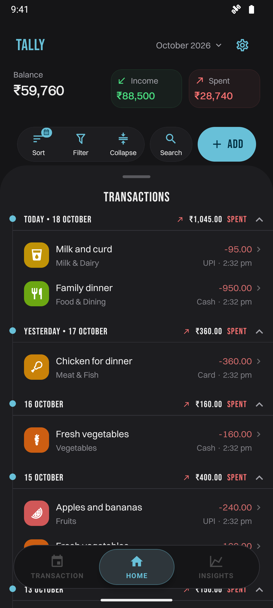
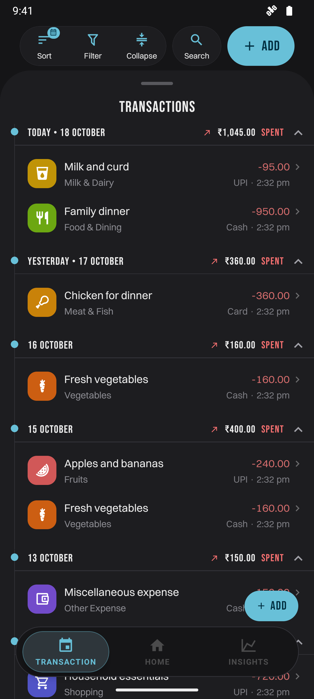
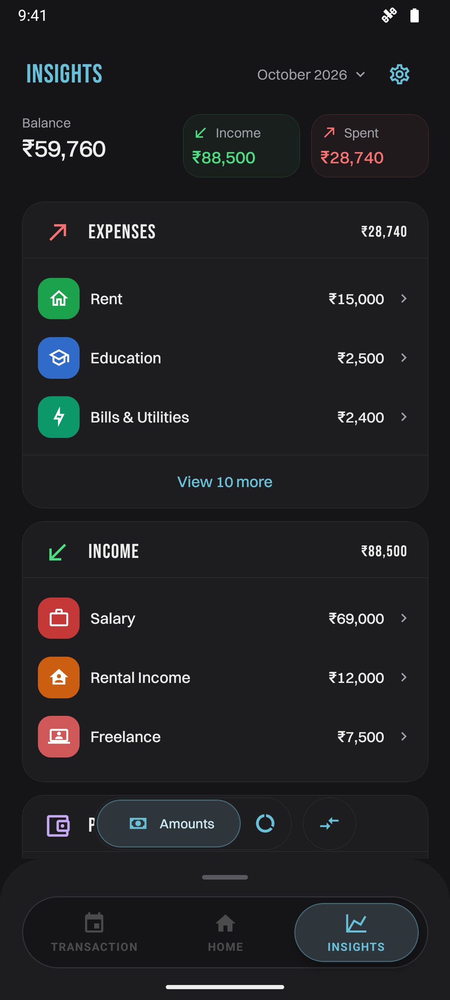
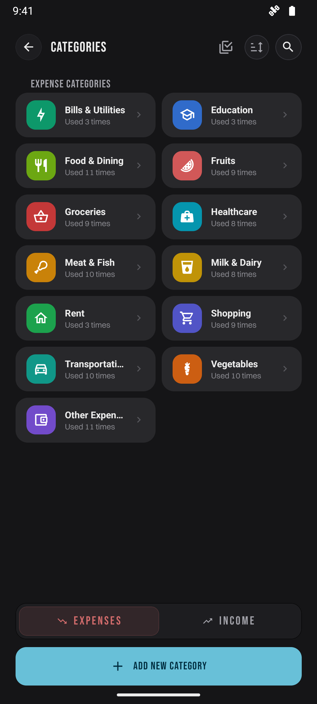
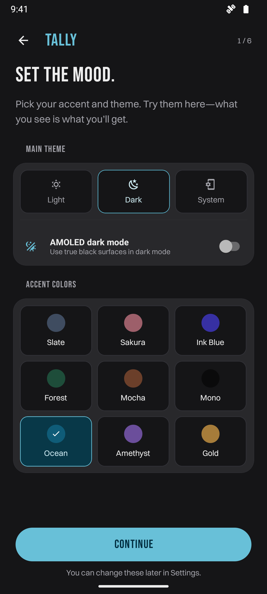
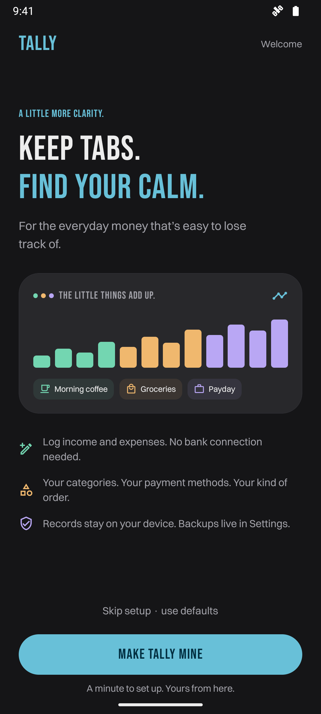
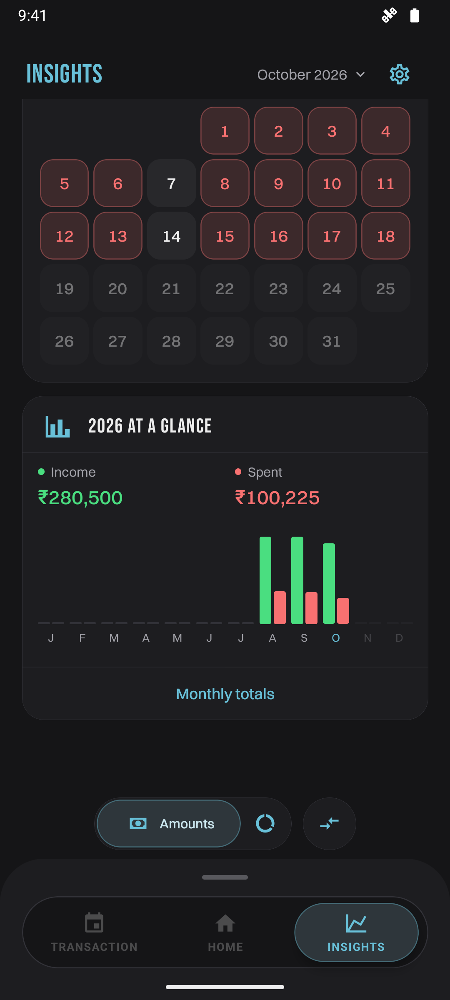

<p align="center">
  
</p>

<h1 align="center">Tally</h1>
<p align="center"><strong>Know where it went.</strong></p>
<p align="center">Small purchases. Big “wait, where did it all go?” energy.</p>

Payday. Rent. Groceries. That innocent little coffee with a supporting cast of snacks. Tally helps you track the whole plot: income, expenses, and the habits hiding between them.

Your records live on your device. You choose when to export a backup. No account signup or bank connection required. Your snack budget has enough people involved already.

## The receipts

<p align="center">
  
  
  
</p>
<p align="center">
  
  
  
</p>

<details>
<summary>Yearly overview</summary>
<p align="center"></p>
</details>

Captured from an Android development build using generated sample data. See the [screenshot notes](assets/screenshots/README.md).

## More than a very judgmental calculator

- **Catch the “it was only ₹99” purchases.** Record income and expenses with categories, payment accounts, dates, and notes. They do, unfortunately, add up.
- **Keep your financial personalities apart.** Separate workspaces have their own currency, categories, accounts, and budgets. Personal, household, side hustle—give each its own corner.
- **Bring numbers to the group chat.** Monthly comparisons, category breakdowns, daily activity, and a year at a glance help you see what actually happened.
- **Make it look like your app.** Accent colors, light and dark themes, AMOLED surfaces, and interface preferences. The budget may be strict. The aesthetic is your business.
- **Back it up. Future you has enough problems.** Export local backups with optional password encryption. Imports validate every row and let you resolve unknown categories and payment accounts before saving.
- **Put a little lock on it.** Biometric locking and local reminders are available on supported devices.

## Working, with a little sawdust

**Current version: 0.1.0 — early preview.** Tally is working, with code cleanup and bug fixes ongoing. The app has its shoes on; the workshop is still open.

SQLite migration safety, backup compatibility, and money precision still need hardening. Keep independent copies of important records while those foundations get tightened up.

Android gets first dibs as the current release target. iOS source is included, but an iOS release has not been verified. Tally uses native modules and needs a development build; it does not run in standard Expo Go.

Android release builds default to ARM64. Universal and other architecture options are available. See [Android releases](docs/android-release.md) for builds, signing, installation, and verification. Release builds have been tested on an emulator and a Xiaomi 12T. Public APK distribution still needs a permanent signing key and a final release-device check.

## Run it yourself, then

You will need **Node.js 22**, npm, and native tools for your platform: **JDK 17 and the Android SDK** for Android, or **macOS, Xcode, and CocoaPods** for iOS.

```sh
git clone https://github.com/Stephenpaul-03/Tally.git
cd Tally
nvm use
npm ci
```

**One font-shaped detour:** download Switzer directly from Fontshare and install the four local font files using the [font setup instructions](assets/fonts/README.md). Switzer is used throughout the app but is not included in the repository. `npm run check:fonts` verifies the local files before building.

Then build and launch the native development app:

```sh
npm run android
# Or, on macOS:
npm run ios
```

For an already installed development build, start Metro with `npm start`. Rebuild the native app after changing native dependencies or Expo configuration; restarting Metro alone will not update native modules.

The `android/` and `ios/` directories are generated by Expo and excluded from Git. Keep persistent native configuration in `app.json` and `plugins/`.

## Make the checks happy

```sh
npm run check:release
```

This runs TypeScript, ESLint, onboarding tests, analytics tests, import/rollback tests, category management tests, notification tests, and release configuration tests. GitHub Actions runs the same checks for pushes and pull requests. See [testing](docs/testing.md) for coverage and device checks.

| Command | Purpose |
| --- | --- |
| `npm start` | Start Metro for a development build |
| `npm run android` | Build and run the Android development app |
| `npm run ios` | Build and run the iOS development app |
| `npm run check:release` | Run static checks and automated tests |
| `npm run check:fonts` | Verify the locally installed Switzer files |
| `npm run build:android:release` | Build an ARM64 release APK |

## The map, for the brave

| Folder | Contents |
| --- | --- |
| `modules/Management/` | Transactions, categories, accounts, and budgets |
| `modules/Insights/` | Calculations, cards, charts, and comparisons |
| `modules/Onboarding/` | Setup flow and spotlight tours |
| `modules/Settings/` | Preferences, data tools, and app settings |
| `modules/Core/` | SQLite storage, repositories, and Redux state |
| `components/`, `hooks/`, `theme/` | Shared UI, behavior, and styling |
| `plugins/`, `scripts/` | Native configuration and release tooling |

## Send bugs. Send ideas. Send the PR.

Found a gremlin, a rough edge, or a better way to do something? Bug reports, ideas, and focused pull requests are welcome. Read [CONTRIBUTING.md](CONTRIBUTING.md) for setup, checks, and tips for reporting a problem. Please use sample data when sharing screenshots, logs, or backups.

Maintainers can use the [GitHub publishing guide](docs/github-publishing.md) for the first public push. Vulnerabilities should be reported according to [SECURITY.md](SECURITY.md).

## License and credits

Copyright © 2026 Stephen Paul. Tally's original code is licensed under the [GNU General Public License v3.0 only](LICENSE) (`GPL-3.0-only`); see [NOTICE](NOTICE). Fonts, currency data, and dependencies retain their own licenses; see [third-party notices](THIRD_PARTY_NOTICES.md).

## Tell me things

If you use Tally or build something with its code, please drop me a friendly hello at [stephenpaul4040@gmail.com](mailto:stephenpaul4040@gmail.com). I’d love to see what you make. Completely optional; always appreciated.

Tell me what you like, what you dislike, what broke, or which button personally offended you. Feature requests, tiny annoyances, big ideas—all feedback is welcome. Be kind. Be honest. I’m listening.

Tally is working and usable. Code cleanup and bug fixes are still going on, and your feedback helps decide what gets attention next.
